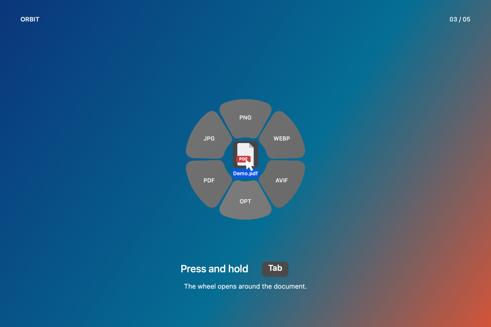
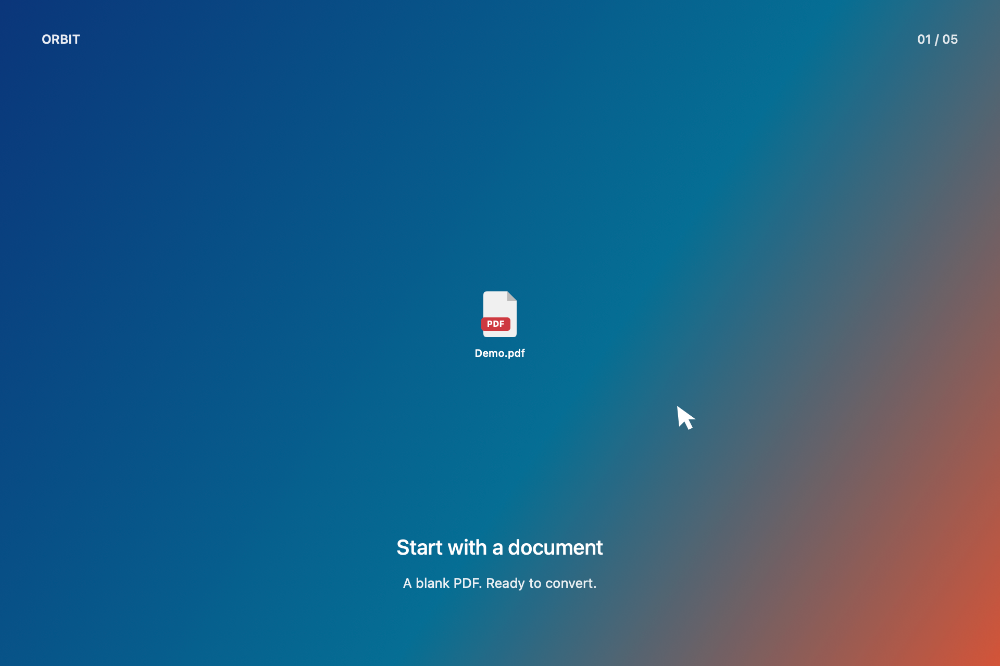
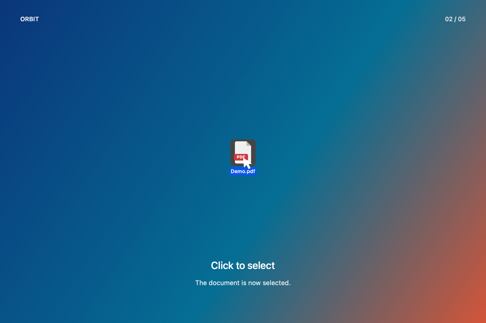
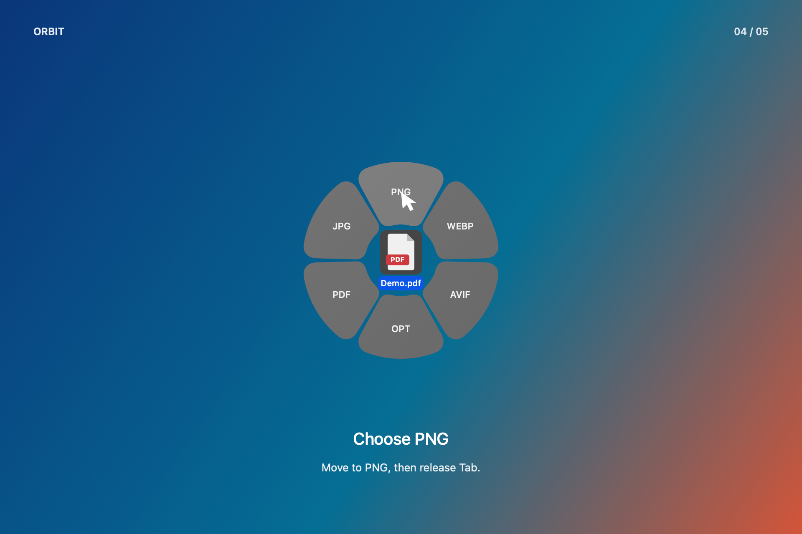
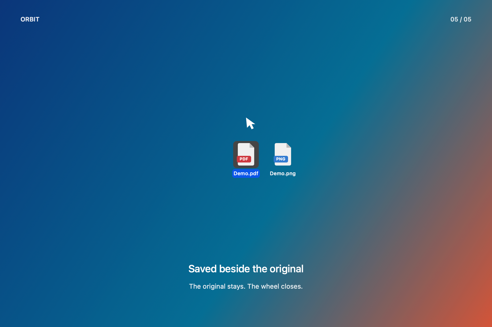

# Orbit

Круговое меню для конвертации изображений и PDF на Mac. Выбираешь файл,
удерживаешь Tab и выбираешь формат. Результат сохраняется рядом с оригиналом.

[English](README.md) · [Устройство приложения](docs/architecture.md) · [MIT](LICENSE)



Версия **0.1.5**. Интерфейс на русском. Orbit работает в строке меню,
без значка в Dock и стартового окна.

[Видео Tab → PNG](docs/media/orbit-demo-color-30fps.mp4) · [GIF](docs/media/orbit-demo-color-30fps.gif).
Снимок сделан в отдельном нативном тестовом окне: [подробнее](docs/demo.md).

## Зачем

Для разовой конвертации не хочется открывать редактор, экспортировать файл
и снова искать исходную папку. Orbit собирает эти действия рядом с файлом.

## Возможности

| Сектор | Действие |
| --- | --- |
| PNG | Конвертация в PNG |
| JPG | JPEG с качеством 0.9; прозрачность заменяется белым фоном |
| WEBP | WebP с качеством 90 через встроенный libwebp |
| AVIF | AVIF, если текущая macOS предоставляет кодек записи |
| PDF | Изображение в PDF; PDF → PDF создаёт точную копию исходных байтов |
| OPT | Оптимизация PNG, JPG и GIF без потери качества через инструменты ImageOptim |

PDF экспортируется в изображения постранично с разрешением 144 dpi. Поддерживается
несколько файлов. Совпадающие имена получают номер, оптимизированные копии —
суффикс `-optimized`. Обработка локальная, без аккаунта, облака и аналитики.

## Сборка и установка

Нужны Apple Silicon Mac, Command Line Tools со Swift 6 и libwebp. Целевая версия
сборки — macOS 14+, проверена macOS 27.0.1. Ранние версии не проверялись.
AVIF зависит от доступного системного кодека.

Если Command Line Tools ещё нет:

```sh
xcode-select --install
```

При установленном [Homebrew](https://brew.sh/) выполни из папки проекта:

```sh
brew install webp
zsh build.sh
```

Перенеси `dist/Orbit.app` в «Программы» и запусти. Сама сборка ничего не устанавливает
и не запускает. Подпись ad hoc, без Developer ID и нотариализации: macOS может
потребовать разрешить запуск в «Конфиденциальность и безопасность». Готового
нотариализованного установщика пока нет.

Другую совместимую установку кодеков можно указать через `ORBIT_WEBP_LIB_DIR` —
папку с `libwebp.7.dylib` и `libsharpyuv.0.dylib`. Исходные библиотеки не меняются.
Python, FFmpeg и сервер приложению не нужны.

Для **OPT** отдельно установи [ImageOptim](https://imageoptim.com/mac) в
`/Applications/ImageOptim.app`. Внутри нужны `oxipng`, `jpegoptim` и `gifsicle`.
Другие форматы работают без ImageOptim.

## Как пользоваться

1. Щёлкни по изображению или PDF в Finder: файл выделится.
2. Оставь указатель над файлом и **удерживай Tab**. Круг появится вокруг указателя.
3. Наведи указатель на нужный формат и **отпусти Tab**. Результат сохранится
   рядом с оригиналом, круг сразу закроется.

Отпускание Tab без выбора закрывает круг. Можно нажать сектор мышью.
Стрелки выбирают PNG / WEBP / OPT / JPG (вверх / вправо / вниз / влево), Escape отменяет.
В режиме ручного выбора файла Tab / Shift + Tab переключают секторы,
Enter или пробел запускает действие.

| 1. Документ | 2. Выделение | 3. Удержание Tab | 4. Выбор PNG | 5. Готово |
| --- | --- | --- | --- | --- |
|  |  |  |  |  |

Через значок в строке меню доступны «Выбрать файл…» и «Показать результат».
Выбор файла из меню работает без жеста Finder и поддерживает несколько файлов.

## Разрешения и автозапуск

Для Tab используется системный хоткей, включённый только в Finder.
Универсальный доступ и мониторинг ввода для него не нужны. При чтении выделения
macOS может запросить «Конфиденциальность и безопасность → Автоматизация → Finder».
Приложение наблюдает события указателя, но не записывает нажатия клавиш.
Ручной выбор файла не читает выделение Finder.

При первом обычном запуске Orbit регистрирует автозапуск. Его можно отключить
кнопкой «Автозапуск». Если macOS требует подтверждение, кнопка откроет настройки
входа. После пересборки или перемещения разрешения могут потребоваться снова.

## Ограничения

- Оригиналы не перезаписываются. При обработанной ошибке пакет откатывает свои
  результаты и удаляет служебные файлы. После аварийного завершения могут
  остаться папки `.orbit-task-*` рядом с исходником.
- OPT запускает отдельные кодеки ImageOptim без его окна, полной цепочки
  инструментов и пользовательских настроек.
- OPT удаляет текстовые метаданные PNG, сохраняя выбранные данные цвета,
  ориентации и анимации. JPEG сохраняет метаданные. Это не инструмент удаления
  личной информации из файлов.
- Конвертация не сохраняет все метаданные и профили. JPG и WebP используют
  сжатие с потерями. PDF → изображение растрирует страницы; распознавания текста нет.
- Анимация не конвертируется; анимированный GIF можно оптимизировать через OPT.
  Зашифрованные PDF, папки, Word/Excel, текст и видео не поддерживаются.
- Общий предел — 100 млн пикселей на изображение или набор страниц PDF.
  Для WebP — 16 383 пикселя по стороне.
- Заливка показывает активность, а не точный процент; доходит до конца после
  обработки, проверки и сохранения.

Если Tab не срабатывает, проверь разрешения или используй «Выбрать файл…».
Если OPT не работает — проверь ImageOptim. Если AVIF недоступен — выбери другой
формат. Папка исходника должна разрешать запись.

Для удаления отключи «Автозапуск», нажми «Завершить Orbit» и удали приложение
из «Программ». Созданные файлы останутся на месте.

## Разработка и лицензия

```sh
zsh build.sh
zsh Tools/check.sh
```

[Проверки](docs/verification.md) · [Демонстрация](docs/demo.md)

Исходный код — [MIT](LICENSE), © 2026 Egor Belyakov. Для WebP и отдельно
устанавливаемого ImageOptim действуют собственные лицензии:
[уведомления](THIRD_PARTY_NOTICES.md).
